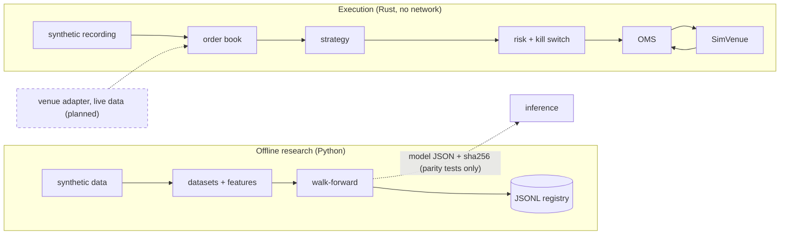

# Fall Forward Labs: quant-core

Private trading research and execution platform, in its foundation phase. A Rust engine replays
market events through risk checks and an order manager against a simulated venue; a Python stack
builds point-in-time datasets, runs walk-forward validation and records every trial. Nothing
trades, nothing connects to a venue for trading, and no strategy has shown an edge.

| Audited | Value |
|---|---|
| Date | 2026-09-27 |
| `main` | `4975ec3` (initial commit, one README). No PR is merged |
| Integration candidate | `integration/base-candidate-2026-09-27` @ `44d1711` (all open PRs except #6; unreviewed) |
| Documentation verdict | **Complete** for this snapshot |
| Engineering foundation verdict | **Partially ready** (reasons in [base-status](docs/reports/base-status.md#verdicts)) |
| Live trading | Disabled and not built. `just paper` refuses; no venue adapter exists |
| Venue connectivity | None. The only market-data network code is study 0001's read-only client for Kalshi's public endpoints |
| Paid agent jobs | None running: no workflows on `main`, no `ANTHROPIC_API_KEY` secret. Once #10 and #13 merge and the key is added, four workflows make paid calls regardless of `autonomy/POLICY.yaml` |
| Auto-merge | Not enabled (`allow_auto_merge: false`); no workflow enables it |

Biggest blockers: nothing is on `main`; `just check` fails at the candidate head (one lint line,
#16 with #12); review rules are unenforceable on the current GitHub plan; the first vertical and
the operators' jurisdiction are undecided.

## Contents

1. [Project and stage](#1-project-and-stage) · 2. [Current state](#2-current-state) ·
3. [What has been built](#3-what-has-been-built) · 4. [What you can run today](#4-what-you-can-run-today) ·
5. [Quickstart](#5-quickstart) · 6. [Architecture](#6-architecture) · 7. [Repository map](#7-repository-map) ·
8. [Research and learning](#8-research-and-learning) · 9. [Safety and operating boundaries](#9-safety-and-operating-boundaries) ·
10. [Working together with Claude](#10-working-together-with-claude) · 11. [Validation and known limitations](#11-validation-and-known-limitations) ·
12. [Decisions and dependencies](#12-decisions-and-dependencies) · 13. [Roadmap](#13-roadmap) ·
14. [Contributing, security, confidentiality](#14-contributing-security-confidentiality) · 15. [Documentation index](#15-documentation-index)

## 1. Project and stage

The ambition ([docs/VISION.md](docs/VISION.md)) is an auditable trading system that earns a
reconciled track record before any talk of a fund. The current stage is narrower: an offline
foundation that either founder can check out, verify and extend. The first market is not chosen:
ADR-0020 proposes Kalshi event contracts, ADR-0003 a crypto-perpetuals shortlist, and both are
Proposed pending the operators' jurisdiction.

## 2. Current state

- All work is on 16 open PRs (#1-#16), every one authored by @SatyamDave and none reviewed.
  The verifier merged them into the integration candidate; #6 was left out because its
  `docs/NOW.md` conflicts with #14's. This PR (#8) is the candidate plus documentation.
- `just check` exits 0 at candidate commit `f4a4537` and 1 at the head `44d1711` (ruff RUF100 at
  `research/studies/0001-favorite-longshot/tests/test_recompute.py:44`).
- CI passed on #13's own head. On the combined tree (this PR's head) `ci` fails on the same
  RUF100 and `security` fails on one trivy HIGH: `.devcontainer/Dockerfile` runs as root. The AI
  reviews fail for want of an API key, before any call. Branch protection and rulesets return
  HTTP 403 on this plan.
- Unverified: the devcontainer (no docker on the verifying machine), any behavior on Linux or on
  a second founder's machine.

## 3. What has been built

| Component | PR | Runs? | Main limitation |
|---|---|---|---|
| Rust workspace, fixed-point core types | #1 | yes, 42 tests | Toolchain floats on `stable`, not ADR-0004's pin |
| Order book, OMS, risk checks, kill switch, SimVenue, replay | #15 | yes, `just replay` | Synthetic fixture; SimVenue ignores queue position |
| Data schemas, quality checks, datasets, features, training, walk-forward, export, monitoring | #12 | yes, `just walkforward demo` | Synthetic data only; DSR gate mis-scaled |
| Rust inference with Python parity | #12 | tests only | Not wired into the engine |
| Experiment registry (JSONL) | #1, #12 | yes | Two ledger paths once #16 merges; not MLflow |
| CLAUDE.md hierarchy, VISION, ARCHITECTURE | #7, #14 | n/a | Guidance, not enforcement |
| `.claude/` settings, hooks, rules, agents, skills | #11 | 30 hook tests | Hooks bind Claude Code sessions only |
| Knowledge-loop workflows and scope check | #10 | 10 tests | Never ran; would call Anthropic |
| CI, security scanners, pre-commit, harden script | #13 | CI green on #13 | Harden script blocked by plan (403) |
| Autonomy tier policy and gate | #3 | 23 tests; gate fails as designed | Loops not built; nothing reads POLICY.yaml |
| Study 0001 favorite-longshot | #16 | ran once | INSUFFICIENT EVIDENCE; not reproducible from a clone |
| ADRs 0001-0006, 0010, 0011, 0013, 0020; plans; data classes | #2-#5, #9 | n/a | All Proposed |
| Contributor docs, templates, devcontainer | #8 | n/a | Devcontainer never built |

Per-component detail with evidence: [docs/audits/0001-reality-audit.md](docs/audits/0001-reality-audit.md).

## 4. What you can run today

On a checkout of this branch (or the integration candidate), offline, with no credentials:

| Command | Kind | What it does | Expected result |
|---|---|---|---|
| `just setup` | setup | `cargo fetch`; `uv sync --locked` | exit 0; creates `research/.venv` |
| `just check` | checks | fmt, clippy, Rust tests, pytest, audits | exit 1 at `44d1711` (RUF100); exit 0 at `f4a4537` |
| `just replay` | offline replay, simulated execution | Replays `tests/replay/sample_day.csv` twice | `run 1/2 order-log sha256: d3400a1a...b8e0`, `replay deterministic`, exit 0 |
| `just walkforward demo` | offline research demo | Synthetic day through features, training, walk-forward | Verdict FAIL, exit 0; modifies committed files (see §11) |
| `just test-hooks` | checks | Hook tests | 30 passed |
| `just learnings` | knowledge | Counts inbox files | `0 untriaged learning(s)` |

Not available:

| Command or capability | Status |
|---|---|
| `just backtest <cfg>` | Placeholder; prints "not implemented yet" and exits 0 |
| `just paper <strategy>` | Refuses and exits 1 by design |
| `just study-0001` | Exits 1 on a fresh clone: raw data is gitignored |
| Exchange demo, paper/shadow, live trading | Not built |
| Devcontainer | Not verified |

## 5. Quickstart

Prerequisites, versions as verified on 2026-09-27 (macOS arm64): Rust/cargo 1.97.1 (the repo asks
for floating `stable` via `engine/rust-toolchain.toml`, honoured only with rustup), uv 0.11.28
(it provides Python 3.12 for `research/`), just 1.58.0, git, and read access to the private repo
`SatyamDave/fall_forward_labs`. Optional for a full audit: cargo-deny, cargo-audit, pip-audit;
without them `just audit` prints `skip:` and still exits 0.

```sh
git clone https://github.com/SatyamDave/fall_forward_labs.git && cd fall_forward_labs
git checkout bootstrap/phase-7-contributor   # main has only a README until the PRs merge
just setup    # downloads crates from crates.io and packages from PyPI
just check    # see §4 for the expected exit code at each commit
just replay   # the smallest offline end-to-end demo
```

Setup downloads dependencies; nothing needs venue credentials or makes a paid call. On the
verifying Mac, cold setup took about 6 s, `just check` 21 s and `just replay` 3 s; your times
depend on network and cache. Success looks like `replay deterministic`. Outputs: replay logs go
to a temp directory; walk-forward writes `backtest/reports/demo/<date>.md` and
`research/registry/log/`.

## 6. Architecture



The engine is the in-house `qc-*` crates; NautilusTrader is only proposed (ADR-0001) and is not a
dependency. Interfaces, state transitions and failure behavior: [docs/ARCHITECTURE.md](docs/ARCHITECTURE.md).

## 7. Repository map

| Path | Purpose | Entry point | Canonical doc |
|---|---|---|---|
| `engine/` | Rust workspace, `qc-*` crates | `cargo test --workspace`, `just replay` | [engine/CLAUDE.md](engine/CLAUDE.md) |
| `research/` | uv project; registry; studies | `research/pyproject.toml` | [research/README.md](research/README.md) |
| `ml/`, `data/` | Model pipeline and data code (run in `research/`'s env) | `ml/validation/walkforward.py` | [ml/CLAUDE.md](ml/CLAUDE.md), [data/CLAUDE.md](data/CLAUDE.md) |
| `backtest/` | Configs and reports; fill and latency models are empty | `backtest/configs/demo.yaml` | [backtest/CLAUDE.md](backtest/CLAUDE.md) |
| `strategies/` | Template only; no strategy | `strategies/_template/` | [GATES.md](strategies/_template/GATES.md) |
| `config/` | Risk limits (protected), environments | `config/limits/default.toml` | [config/venues/README.md](config/venues/README.md) |
| `tests/` | Replay fixture, hook, knowledge, autonomy tests | `tests/replay/sample_day.csv` | [tests/replay/README.md](tests/replay/README.md) |
| `autonomy/` | Tier policy and classifier (protected) | `autonomy/classify.py` | `autonomy/POLICY.yaml` |
| `.claude/` | Settings, hooks, rules, agents, skills | `.claude/settings.json` | [how-this-repo-learns](docs/onboarding/how-this-repo-learns.md) |
| `.github/` | CI, scanners, knowledge loop, templates, CODEOWNERS | `.github/workflows/ci.yml` | [SECURITY.md](SECURITY.md) |
| `scripts/` | Repo hardening, knowledge scripts | `scripts/harden-repo.sh` | [github-hardening](docs/runbooks/github-hardening.md) |
| `agents/`, `ops/`, `fund/` | Placeholders (READMEs, one Terraform template) | none | their `CLAUDE.md` |
| `docs/` | Vision, architecture, ADRs, plans, specs, runbooks, reports | this README | §15 |

## 8. Research and learning

Implemented lifecycle: synthetic book events → quality checks (gaps, duplicates, skew) →
point-in-time dataset with a content hash → `tob-v1` features → logistic regression with a fixed
seed → purged, embargoed walk-forward with deflated Sharpe and PBO → trials and a challenger in
the JSONL registry → a dated report. Export writes a JSON model plus sha256 that the Rust
`qc-inference` crate loads and matches within tolerance in parity tests. Monitoring code demotes
automatically and refuses promotion without a human-approval record.

Nothing learns online, no model has seen real data, and nothing has been promoted past
challenger. "Learning" here means four separate things, and only the first two are partly built:

- **Research memory:** registry, [graveyard](docs/research/graveyard.md), study reports. Built.
- **Predictive training:** the ml pipeline above. Built, exercised on synthetic data only.
- **Agent and knowledge changes:** hooks and knowledge-loop workflows (#10, #11). Never ran.
- **Online adaptation (L0-L3):** ADR-0013 only. Deferred.

Study 0001 (#16) tested favorite-longshot bias on settled Kalshi markets under a pre-registered
design: INSUFFICIENT EVIDENCE, because the frozen listing cap dropped all 40 days and 0 markets
were analysed. The hypothesis is untested, not refuted. Process: [docs/process/research-cycle.md](docs/process/research-cycle.md).

## 9. Safety and operating boundaries

- **Risk checks** (`engine/crates/risk`, protected): kill switch, invalid order, stale data,
  daily loss, price band, notional, position, order rate, each with boundary tests. Limits come
  from `config/limits/default.toml` (unreviewed defaults).
- **Kill switch:** stops new submissions and sends cancel requests for working orders, in the
  simulated engine. Cancels are not confirmed, positions are not flattened, and no operator
  command engages it. [docs/runbooks/kill-switch.md](docs/runbooks/kill-switch.md).
- **Protected paths:** root [CLAUDE.md](CLAUDE.md) rule 3 plus `autonomy/`. `guard-protected.sh`
  blocks Claude Code Edit/Write there; Bash and humans are not blocked. No GitHub rule enforces
  review ([docs/TEAM.md](docs/TEAM.md#review-and-the-enforcement-gap)).
- **Secrets and data:** none in git; `.env*` denied to Claude Code by settings and hooks; raw data
  gitignored. Data classes for external providers: [docs/security/data-classes.md](docs/security/data-classes.md).
  A hosted coding assistant reading files is not local-only processing.
- **Human decisions:** anything touching risk, limits, capital, credentials, deployment, or
  evaluation integrity.

## 10. Working together with Claude

Start at [CLAUDE.md](CLAUDE.md) and [docs/NOW.md](docs/NOW.md). Shared instructions are committed:
root and nested `CLAUDE.md`, `.claude/rules`, skills and agents; `.claude/settings.json` is
protected. Personal memory is not a source of truth: checkpoint in the PR or NOW.md. Ownership
and handoffs: [docs/TEAM.md](docs/TEAM.md). Onboarding: [docs/onboarding/day-1.md](docs/onboarding/day-1.md).
Whether both founders' sessions load identical context has not been checked (`/context` is
interactive).

## 11. Validation and known limitations

Dated evidence: [docs/reports/base-status.md](docs/reports/base-status.md). In short:

- Passed: setup, Rust tests, pytest, audits, replay determinism, hook/knowledge/autonomy suites.
- Failed: `just check` at the candidate head (RUF100); `just study-0001` on a fresh clone; CI
  `ci` and `security` (trivy DS-0002) on the combined tree.
- Not run or unavailable: devcontainer, fuzzing, bench timings.
- False greens: `just backtest` and audit skips exit 0; walk-forward exits 0 on FAIL.
- Hook, knowledge, autonomy and study suites are outside `just check` and CI.
- `just walkforward demo` overwrites the committed dated report and appends to the committed
  registry, so each run inflates the trial count used by deflated Sharpe.
- Synthetic fixtures establish mechanics and determinism, never fills, latency or edge.

## 12. Decisions and dependencies

| Decision | Status | Blocks | Owner |
|---|---|---|---|
| First vertical: ADR-0020 (Kalshi) vs ADR-0003 | Proposed | M1 | founders |
| Operators' jurisdiction, entity | Unknown | Any venue account | founders, with counsel |
| ADR-0001 NautilusTrader (LGPL-3.0 flagged for legal review in ADR-0002) | Proposed; not used | Engine dependency choice | founders |
| ADR-0004 toolchain pin, ADR-0005 MLflow | Proposed; code differs | Pin PR, registry migration | founders |
| TypeSafe MCA §2.3(b) distillation clause (ADR-0011) | Blocks decision-layer distillation | Decision layer | legal review |
| GATES.md thresholds, DSR gate units | Unreviewed | Any promotion | founders |
| Second founder, GitHub plan | Unknown | Enforced review | founders |

## 13. Roadmap

M0 is the offline foundation on `main`; M1 is the first specialization, after the vertical is
chosen. Full list, deferred items with reasons, and the historical "base complete" checklist:
[docs/ROADMAP.md](docs/ROADMAP.md). Next three steps:

1. Fix the two integration defects in #16 (drop the noqa, use `research/registry/log/`).
2. Merge the PRs in the [base-status merge sequence](docs/reports/base-status.md#merge-sequence).
3. Register study 0001 v2 with a population measured by metadata-only calls first.

## 14. Contributing, security, confidentiality

[CONTRIBUTING.md](CONTRIBUTING.md) covers branches, commits, checks and PRs; the PR and issue
templates are in `.github/`. Report vulnerabilities privately per [SECURITY.md](SECURITY.md).
The repository is private and has no LICENSE file; it is not open source and must not be
published. No IP-assignment or founders' agreement exists in the repository; that is a task for
the founders and their counsel.

## 15. Documentation index

- **Founder:** this README → [NOW](docs/NOW.md) → [base-status](docs/reports/base-status.md) →
  [ROADMAP](docs/ROADMAP.md) → [TEAM](docs/TEAM.md) → [specs index](docs/specs/README.md).
- **Engineer:** [CONTRIBUTING](CONTRIBUTING.md) → [day-1](docs/onboarding/day-1.md) →
  [ARCHITECTURE](docs/ARCHITECTURE.md) → [engine/CLAUDE.md](engine/CLAUDE.md) →
  [kill-switch runbook](docs/runbooks/kill-switch.md) → [GLOSSARY](docs/GLOSSARY.md).
- **Researcher:** [research-cycle](docs/process/research-cycle.md) →
  [reality audit](docs/audits/0001-reality-audit.md) → [research/README.md](research/README.md) →
  [GATES.md](strategies/_template/GATES.md) → [graveyard](docs/research/graveyard.md) →
  [ADRs](docs/adr/).
