# Architecture

quant-core has two halves that share data but never share a process: an offline side (recorders, research, ML, the agent swarm) and a live side (the Rust engine). Models cross from offline to live only as exported, hash-checked artifacts. No AI call crosses into the engine (root rule 1).

## Components and data flow

```mermaid
flowchart LR
  venue[(Venues)]

  subgraph offline["Offline side: no venue trading keys"]
    direction LR
    rec["data/recorders<br/>Parquet, exchange + local ts"]
    dq["data/quality<br/>gaps, duplicates, clock skew"]
    cat[("data/catalog<br/>object storage index")]
    res["research/<br/>point-in-time features,<br/>walk-forward"]
    sbx["research/sandbox<br/>factor discovery,<br/>no credentials"]
    bt["backtest/<br/>fill + latency models"]
    ml["ml/<br/>datasets, features, train,<br/>validate, monitor"]
    reg[("experiment + model<br/>registry")]
    exp["ml/export<br/>artifact + registry hash"]
    swarm["agents/<br/>offline swarm"]
    prs["branches, PRs,<br/>reports, registry entries"]
  end

  subgraph engine["engine/ (Rust, deterministic): the hard boundary, no AI calls cross it"]
    direction LR
    gw_in["qc-gateway<br/>market data in"]
    book["qc-orderbook"]
    strat["qc-strategy-runtime<br/>+ strategies/"]
    inf["qc-inference"]
    risk["qc-risk (protected)"]
    oms["qc-oms"]
    gw_out["qc-gateway<br/>orders out"]
  end

  human{{"human approval"}}

  venue -- market data --> rec --> dq --> cat
  cat --> res --> bt
  cat --> ml
  sbx -- candidate factors --> res
  res --> reg
  bt --> reg
  ml --> reg
  reg --> exp
  exp -- promotion dossier --> human
  human -- approved artifact --> inf

  venue -- market data --> gw_in --> book --> strat
  inf -- "Signal or no signal" --> strat
  strat -- OrderRequest --> risk -- passed --> oms --> gw_out --> venue
  gw_out -. "fills, acks" .-> oms

  swarm --> prs
  prs -. human review .-> human
```

Read left to right:

1. **Recorders** (`data/recorders`) write venue market data to Parquet with both exchange and local timestamps. **Quality checks** (`data/quality`) run on ingest, and the **catalog** (`data/catalog`) records what exists and where.
2. **Research** (`research/`) and **ML** (`ml/`) read point-in-time data from the catalog. Backtests (`backtest/`) and walk-forward runs record every trial, failures included, in the **registry**. The **sandbox** (`research/sandbox`) proposes candidate factors that re-enter the same gates and count toward the trial total.
3. **Export** (`ml/export`) produces a small deterministic model artifact stamped with its registry hash. Promotion to live needs statistical gates and a human approval.
4. Inside the **engine**, `qc-gateway` brings market data in, `qc-orderbook` maintains the book, and `qc-strategy-runtime` drives strategies with events. `qc-inference` loads only approved, hash-matching artifacts and returns a signal or no signal.
5. Every `OrderRequest` passes `qc-risk` (limits, stale data, kill switch) before `qc-oms` tracks it and `qc-gateway` sends it. Fills and acknowledgements flow back to the OMS, which reconciles with the venue.
6. The **agent swarm** (`agents/`) runs on the offline side only. Its outputs are branches, PRs, reports, and registry entries, all of which pass human review.

## Boundaries

- **The engine boundary.** No crate under `engine/` and no process holding venue credentials calls an AI API. Models enter only as exported artifacts; there is no runtime download.
- **Credentials.** Venue keys are trade-only, IP-allowlisted, and scoped per strategy and environment. They are injected into the gateway at runtime from the secret manager and never exist on the offline side.
- **Determinism.** The engine reads time only through `qc_core::Clock`, uses fixed-point `Price` and `Qty`, and avoids hash-ordered collections, so `qc-replay` can replay a recorded day and reproduce identical orders.
- **Protected zones.** `engine/crates/risk`, `config/limits`, `ops/deploy`, `fund`, `.github/workflows`, `.claude/hooks`, `.claude/settings.json`, and `autonomy/` change only with human approval.

## Supporting crates

- `qc-core`: fixed-point prices and quantities, IDs, clocks, events shared by every crate.
- `qc-telemetry`: metric types and sinks kept off the hot path.
- `qc-replay`: replays recorded events through a strategy to reproduce its orders.
- `qc-benches`: criterion benchmarks for hot paths.
