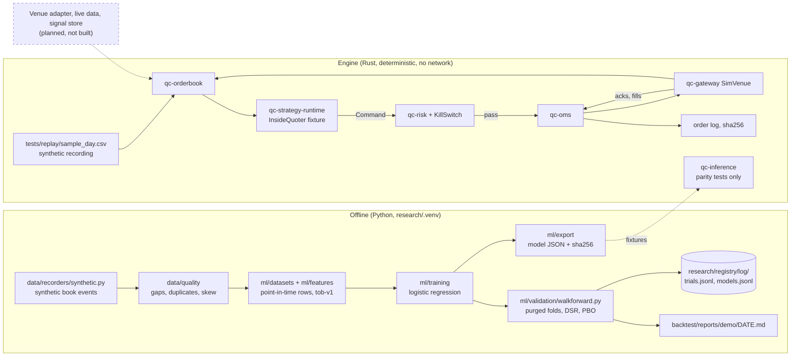

# Architecture

What is built on the integration candidate (`44d1711`, 2026-09-27), then what is planned. Nothing
here is on `main` yet; see [docs/reports/base-status.md](reports/base-status.md).

quant-core has two halves that share files but never a process: an offline side (data, research,
ML, reports) and an execution side (the Rust engine). Today the execution side runs only against a
simulated venue on a synthetic recording. No code connects to any venue, reads credentials, or
calls an AI API.

The engine is the in-house `qc-*` crates under `engine/crates/`. ADR-0001 (Proposed) recommends
building on NautilusTrader and hftbacktest; neither is a dependency, and nothing here wraps them.

## Current flow

## Modules and interfaces

| Crate or package | Interface | Behavior today |
|---|---|---|
| `qc-core` | `Price`, `Qty` (fixed-point `i64`, scale 1e8), IDs, `Timestamp`, `Clock`/`SimClock`, `MarketEvent`, `OrderEvent`, `OrderRequest` | No floats for money; time only through `Clock` or events |
| `qc-orderbook` | `OrderBook::apply_snapshot`, `apply(&BookDelta)`, `status()` | Rejects crossed or locked results, sequence gaps, negative quantities; moves to `NeedsResync` until a snapshot; 256 levels a side |
| `qc-strategy-runtime` | `Strategy::on_event(&mut self, &Event, &OrderBook, &mut Vec<Command>)`; `Command::{Submit, Cancel}` | `InsideQuoter` is a test fixture, not a strategy |
| `qc-risk` (protected) | `RiskCheck::check(&OrderRequest, &RiskContext) -> Result<(), RiskReject>`; `RiskEngine`; `KillSwitch` | Kill switch first, then invalid order, stale data, daily loss, price band, notional, position (incl. open orders), order rate (1 s window). Limits from `config/limits/default.toml` |
| `qc-oms` | `Oms::insert`, `request_cancel`, `apply(&OrderEvent)`; `reconcile(&Oms, &[VenueOrder])` | Exhaustive 7-state machine; refuses overfills; any reconciliation discrepancy returns `halt() == true` |
| `qc-gateway` | `VenueAdapter { submit, cancel, poll, order_snapshot }`; record parser; `SimVenue`; `TokenBucket`; `reconnect_delay_ms` | Only `SimVenue` implements the trait. It ignores queue position and does not reduce displayed size, so two aggressive orders can take the same quantity |
| `qc-replay` | `Engine::on_record`, `reconcile`; binary `qc-replay <recording> <log> [limits.toml]` | Runs book, strategy, risk, OMS and SimVenue; reconciles every 60 s of simulated time |
| `qc-inference` | `Model` trait; `LinearModel::load(bytes, expected_sha256)`; `FeatureState` | Loads only when the hash matches; Python/Rust parity tests on fixtures. Not wired into the replay engine |
| `qc-telemetry`, `qc-benches` | `MetricSink`; criterion benches | Benches build; no numbers recorded |
| `data/`, `ml/` (Python) | schemas, quality checks, datasets, features, training, validation, registry, monitoring, export | Runs from `research/`'s uv environment |
| `research/registry/` | `record(path, entry)`, `trial_count(path, experiment)` | Append-only JSONL; the path is chosen by the caller (see base-status: two ledgers) |

## State transitions

Order states in `qc-oms` (`transition()` in `engine/crates/oms/src/lib.rs`):
`PendingNew → New` on accept; any live state → `PartiallyFilled` / `Filled` on fills;
`PendingNew | New | PartiallyFilled → PendingCancel` on a cancel request; `PendingCancel →
Canceled`, or back to `New`/`PartiallyFilled` on `CancelRejected`; fills may still race a pending
cancel. `Filled`, `Canceled` and `Rejected` are terminal. Illegal pairs return `None`, which halts
the engine (`IllegalOrderEvent`).

Book status: a new book accepts only a snapshot; then `Synced` → `NeedsResync` on any rejected
delta → `Synced` after a valid snapshot.

Engine halt: `halted = None` until one of `KillSwitch`, `IllegalOrderEvent`, `Reconciliation`, or
`Runaway` (one record causing more than 10,000 follow-up events). Halting is one-way within the
process.

## Failure behavior

| Failure | What happens | What does not happen |
|---|---|---|
| Kill switch engaged (another thread) | Next record: engine halts, risk rejects new orders, cancel requests sent for every working order | Cancels are not confirmed; positions are not flattened; no external command engages it |
| Sequence gap or crossing delta | Delta rejected, book `NeedsResync`, strategy pulls quotes | No guessed book |
| Stale data past `stale_data_ms` | Risk rejects new orders | Existing orders stay until the strategy cancels |
| Daily loss reaches `max_daily_loss` | Risk rejects every new order, including risk-reducing ones | Not an engine halt; working orders are not cancelled by it |
| Reconciliation discrepancy, including an unknown venue order | Engine halts and cancels | |
| Model artifact hash mismatch | `LinearModel::load` returns an error | Provenance is not proven: the same PR can change bytes and hash |
| Walk-forward gate miss | Report says FAIL | Exit code stays 0; a challenger is still registered |

## Data and artifact flow

| Artifact | Written by | Location | Committed? |
|---|---|---|---|
| Replay fixture | `tests/replay/generate_sample_day.py` | `tests/replay/sample_day.csv` (synthetic) | yes |
| Replay order log | `just replay` | a temp directory; hash printed | no |
| Synthetic market data | `data/recorders/synthetic.py` | `data/raw/synthetic/` | no (gitignored) |
| Trials, challengers | `just walkforward` | `research/registry/log/*.jsonl` | yes (includes demo rows) |
| Walk-forward report | `just walkforward` | `backtest/reports/<name>/<date>.md` | yes; a rerun overwrites it |
| Model artifact | walk-forward | `backtest/reports/raw/` | no |
| Study 0001 raw pages | `fetch.py` (network) | `data/raw/study-0001/` | no; hashes in `data/catalog/study-0001.json` |
| Study 0001 results | `just study-0001` | `research/studies/0001-favorite-longshot/results.json` | yes |

## Boundaries

- No crate under `engine/` makes a network call or reads credentials; no process calls an AI API.
- Protected paths are listed in root `CLAUDE.md` rule 3. What enforces them today, and what does
  not, is in [docs/TEAM.md](TEAM.md#review-and-the-enforcement-gap).

## Planned, not built

| Component | Source | Blocked on |
|---|---|---|
| Venue adapter, market-data recorder, catalog in object storage | Bootstrap spec, ADR-0005, ADR-0020 | Vertical and jurisdiction decision |
| Fill and latency models with queue position (`backtest/`) | Bootstrap spec, ADR-0001 | Real data |
| `just backtest`, paper trading | justfile placeholders | Adapter and fill model |
| Slow-signal store with staleness and influence bounds | Final base spec | Vertical |
| Decision layer (`platform/decide`) | ADR-0010, ADR-0011 | Measured need; distillation blocked |
| L0-L3 learning, autonomy loops B-H, agent swarm | ADR-0013, ADR-0006, POLICY.yaml | A validated signal; enforced review |
